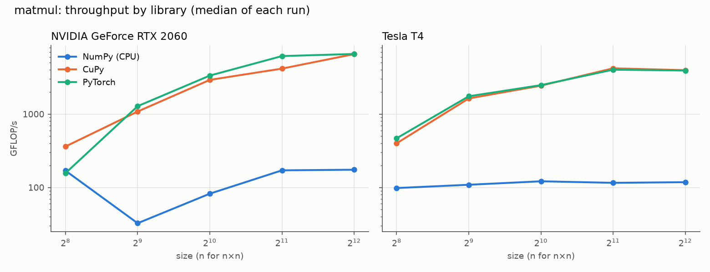
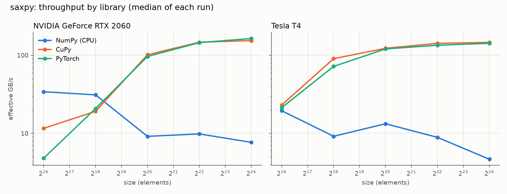
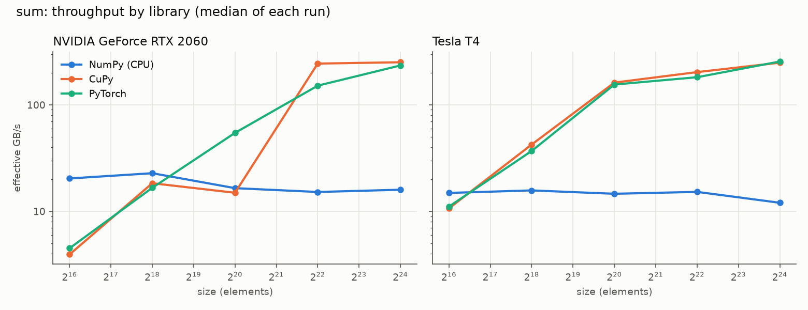
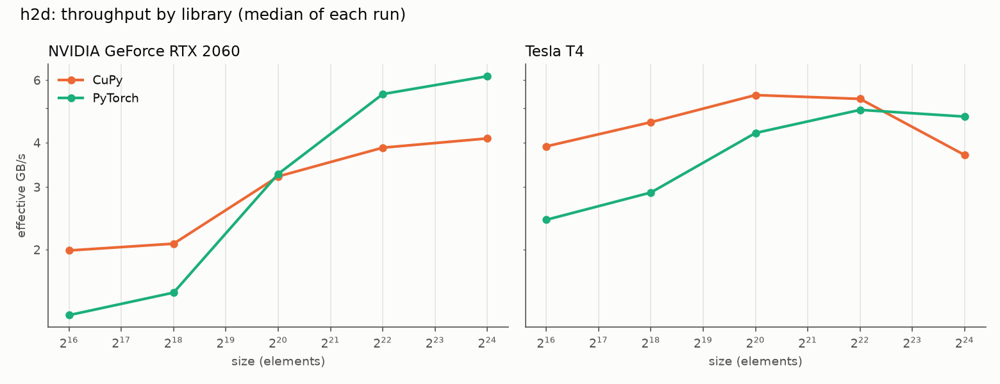
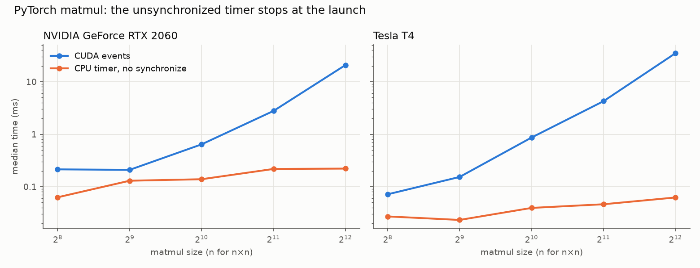

# Phase 1 — Timing the GPU correctly

This phase answers one question: **how fast is the same operation on the
CPU and on the GPU, when it is timed correctly?** The hard part is the word
*correctly*. A GPU call in Python returns before the GPU has done the work,
so a stopwatch around it can report a time that has nothing to do with the
work. The harness in [`bench/`](../bench/) times every GPU call three ways,
including the wrong one, so the error is measured instead of assumed.

The working log, with every expectation written before its run, is in
[`phase-1-notes.md`](phase-1-notes.md).

## What was measured

| Operation | What it does | Sizes | Metric |
|---|---|---|---|
| `matmul` | `C = A @ B`, square float32 matrices | n = 256 … 4096 | GFLOP/s (2n³ operations) |
| `saxpy` | `y = a*x + y`, float32 vectors | 2¹⁶ … 2²⁴ elements | effective GB/s (12 bytes per element) |
| `sum` | sum of a float32 vector | 2¹⁶ … 2²⁴ elements | effective GB/s (4 bytes per element) |
| `h2d` | copy a vector from CPU memory to the GPU | 2¹⁶ … 2²⁴ elements | effective GB/s (4 bytes per element) |

Each with NumPy on the CPU, and CuPy and PyTorch on the GPU, on two
machines: the desktop's RTX 2060 (under WSL2) and a Tesla T4 on Google
Colab. Both GPUs are Turing, so the comparison is a consumer card against a
data-center card of the same architecture.

## How the harness times a call

- **Three clocks for every GPU call:**
  - **CUDA events**, the reference: two markers placed in the GPU's own
    queue, around the call; the GPU records the time when it reaches each
    one. One pair is created per backend, before any timing, and reused.
    When the GPU finishes a tiny call before Python has queued the end
    marker, the GPU waits in between, so the events then include that
    host-side time too.
  - **A CPU timer with synchronization** before starting and before
    stopping the clock: correct, but it also counts the cost of
    synchronizing.
  - **A CPU timer without synchronization**, kept on purpose as the wrong
    way. It does synchronize before starting, and after stopping, outside
    the timed region, so each repetition starts from an empty queue; the
    clock itself stops as soon as Python gets control back.
- **20 warm-up calls** are discarded before timing, then **30 repetitions**
  are timed, and the **median** is reported, with the relative standard
  deviation (RSD, the standard deviation over the mean) beside it.
- **Every result is checked** against a float64 reference computed with
  NumPy once per operation and size, before any library runs, with a
  tolerance per operation. A fast wrong answer is not a result.
- **Every row of the CSV carries the environment stamp** from phase 0, the
  git commit the code ran from (marked `+dirty` if it had uncommitted
  changes), the seed of the inputs, the BLAS NumPy uses, the thread-count
  environment variables, and PyTorch's float32 matmul precision.
- **Tested without a GPU:** [`tests/`](../tests/) use fake GPU backends and
  a stand-in for PyTorch to check that the synchronized timer counts the
  wait and the unsynchronized one does not, that PyTorch's events are not
  created inside a timed call, that warm-up calls run, that the reference
  is not recomputed, the median and RSD, the throughput math, a failing
  correctness check, the seed, and the `+dirty` marker. The charts are not
  tested.

## Results

The numbers below come from **Run 5** (RTX 2060) and **Run 4** (Tesla T4),
both on the code after the audit fixes (see below). Every
(operation, library, size) result passed its float64 check: 55 checks per
run, each shared by the three clock rows of that result. Medians of 30
repetitions after 20 warm-up calls; GPU times from CUDA events.

**matmul, 4096 × 4096**

| | RTX 2060 | Tesla T4 |
|---|---:|---:|
| NumPy (CPU) | 796 ms · 173 GFLOP/s | 1,182 ms · 116 GFLOP/s |
| CuPy | 20.8 ms · 6,593 GFLOP/s | 30.7 ms · 4,480 GFLOP/s |
| PyTorch | 21.0 ms · 6,539 GFLOP/s | 31.2 ms · 4,409 GFLOP/s |
| PyTorch vs NumPy | **38×** | **38×** |

**saxpy, 2²⁴ elements**

| | RTX 2060 | Tesla T4 |
|---|---:|---:|
| NumPy (CPU) | 25.8 ms · 7.8 GB/s | 44.0 ms · 4.6 GB/s |
| CuPy | 1.30 ms · 155 GB/s | 1.38 ms · 146 GB/s |
| PyTorch | 1.22 ms · 166 GB/s | 1.43 ms · 141 GB/s |
| PyTorch vs NumPy | **21×** | **31×** |

**sum, 2²⁴ elements**

| | RTX 2060 | Tesla T4 |
|---|---:|---:|
| NumPy (CPU) | 4.20 ms · 16 GB/s | 5.57 ms · 12 GB/s |
| CuPy | 0.27 ms · 252 GB/s | 0.27 ms · 249 GB/s |
| PyTorch | 0.29 ms · 235 GB/s | 0.26 ms · 256 GB/s |

**h2d, 2²⁴ elements (64 MiB)**

| | RTX 2060 | Tesla T4 |
|---|---:|---:|
| CuPy | 16.8 ms · 4.0 GB/s | 18.1 ms · 3.7 GB/s |
| PyTorch | 11.1 ms · 6.1 GB/s | 14.1 ms · 4.8 GB/s |






How to read these numbers:

- **Each GPU is compared only with the CPU of its own machine.** The two
  CPUs are very different chips (phase 0), so the ratios are not
  comparable across machines.
- **The NumPy `saxpy` time includes allocating two new 64 MiB arrays on
  every call** (`a*x` and the result), while the GPU libraries reuse
  memory from a pool. Part of the `saxpy`
  ratio is that allocation, not arithmetic; how much was not measured on
  these machines.
- **T4 numbers are uncertain by at least 12%:** two Colab sessions on the
  same T4 model measured CuPy `matmul` 4096 at 34.7 ms (Run 2) and 30.7 ms
  (Run 4). The harness changed between them (the reference moved before
  the timing), so session and harness are not separated; on the RTX 2060,
  the same change moved that number by under 1%.
- **CuPy and PyTorch tie on `matmul` at 4096** (both call cuBLAS), but not
  at every size: at 2048 on the RTX 2060, CuPy read 4.11 ms against
  PyTorch's 2.83 ms, for the warm-up reason below.

## The main finding: the unsynchronized timer measures the launch



Without synchronization, the CPU timer stops when the call has been
*queued*, not when it has *finished*. On PyTorch `matmul` 4096:

| | CUDA events | CPU timer, no synchronize | Implied throughput | Error |
|---|---:|---:|---:|---:|
| RTX 2060 | 21.0 ms | 0.21 ms | 651 TFLOP/s | ~100× |
| Tesla T4 | 31.2 ms | 0.07 ms | 1,872 TFLOP/s | ~425× |

Both "results" are impossible: about 100× and 425× what each card measured
with events. At the smallest sizes the gap shrinks, because launching is
most of the cost there (on `saxpy` 2¹⁶ on the RTX 2060: close on CuPy,
0.063 against 0.062 ms; 2× apart on PyTorch, 0.109 against 0.054 ms) —
which is what makes the mistake easy to miss when testing with small
inputs.

## The audit, and what it changed

After the first two runs, an independent review checked every number in
these docs against the CSVs and every claim against the code. It found a
bug in the reference clock itself: **PyTorch creates a CUDA event lazily,
on its first `record()`**, and the harness created a new pair per call, so
the end event was created inside the timed region. Whenever the GPU
finished before that, the creation time was counted.

Fixed in `d443e23`: one pair, created and recorded once before timing. The
same review led to computing the float64 reference once per size (it used
to run between the first call and the timing, leaving the GPU idle), to
recording the git commit and the seed on every row, to stronger tests, and
to correcting several statements in this write-up.

What the fix changed, on PyTorch's CUDA events:

| | Before (Runs 1 and 2) | After (Runs 5 and 4) |
|---|---:|---:|
| RTX 2060, `matmul` 256 | 0.214 ms (CuPy: 0.093) | 0.079 ms (CuPy: 0.096) |
| T4, `matmul` 1024, events vs synchronized timer | 0.866 vs 0.537 ms | 0.529 vs 0.527 ms |
| Median of events minus synchronized timer, RTX 2060 | 4.1 µs | 0.4 µs |
| Median of events minus synchronized timer, T4 | 2.5 µs | 0.8 µs |

The count of (operation, size) pairs where the synchronized timer read
below the events stayed at 11 of 20 on PyTorch on both machines: at the
smallest sizes the two clocks differ by microseconds of host-side work,
and which one reads higher is not a rule. The medians above are the better
measure.

On the RTX 2060, the large sizes did not move beyond the run-to-run noise
(`matmul` 4096: 20.9 ms before, 21.0 ms after). The T4's moved 12% (3.9 to
4.4 TFLOP/s), within what two T4 sessions can differ. Runs 1 and 2 stay in
`results/` as the before.

Run 3, the first run on the RTX 2060 after the fix, was discarded: VS Code,
Spotify and a browser were open, and NumPy `matmul` 4096, whose code did
not change, took 29% longer than in Run 1 (1,016 against 787 ms). Run 5
repeated it with nothing else open, and on the same measure NumPy came back
to within 1% (796 ms), so it counts.

## Decisions

- **CUDA events as the reference clock**, because they are recorded by the
  GPU itself; the synchronized CPU timer is kept as a cross-check.
- **The wrong clock stays in the harness and in every CSV**, as a control:
  the error is part of the result.
- **Median, not mean**, with the RSD beside it: one slow repetition (the
  display, the OS) moves the mean and barely moves the median.
- **Warm-up raised from 2 to 20 calls**, after a measurement (below).
- **One set of inputs and one float64 reference per operation and size,
  shared by every library**, so the comparison runs on the same data.
- **Sizes overridden only for one operation at a time**: 4096 is a
  4096 × 4096 matmul but a 4096-element vector.
- **Colab through a small script**, [`scripts/colab_run.py`](../scripts/colab_run.py):
  `colab run` uploads one file, so the script clones this repository on the
  VM, runs the harness, and prints the CSV for saving locally.
- **A run with a failed control is kept and labeled, not deleted**: Run 3
  stays in `results/`, and the notes say why it is not used.
- **Charts as small multiples**, one panel per GPU on a shared axis, with
  one fixed color per library; the clocks chart uses neutral colors, so a
  clock never borrows a library's color.

## Found along the way

- **Warm-up may need time, not a number of calls (a hypothesis for
  phase 2).** In a short check before the first full run (not saved as a
  CSV), CUDA events read 27% slower than the synchronized timer on a 1024
  matmul on the RTX 2060 with 2 warm-up calls, and 2% with 20. In the full
  runs, CuPy `matmul` 2048 comes right after seconds of NumPy on the same
  size, with the GPU idle, and its events read above the synchronized
  timer in Runs 1, 4 and 5 (4.11 against 2.99 ms on the RTX 2060 in Run 5;
  6.07 against 3.80 ms on the T4 in Run 4), by 4% in Run 3, and not at all
  in Run 2. A GPU still raising its clock would explain it; the clock was
  not measured, which is what phase 2 adds.
- **The RTX 2060 exceeded its rated number:** 6.59 TFLOP/s measured,
  against 6.45 TFLOP/s computed from its rated boost clock
  (1,920 cores × 1.68 GHz × 2), which implies it ran above that clock. The
  clock itself was not measured; that is phase 2.
- **The T4 was far more stable:** a median RSD of 5.1% on the reference
  clocks (Run 4) against 15.8% on the RTX 2060 (Run 5), which also drives
  the display and runs under WSL2. Over all 135 rows: 6.7% and 16.7%.
- **Small GPU calls were 2–3× faster on Colab:** `saxpy` 2¹⁶ took 0.031–
  0.036 ms on the T4 against 0.063–0.109 ms on the RTX 2060. Most of that
  time is host-side work (Python, the driver, and WSL2 on the desktop), on
  two different CPUs, so the cause is not isolated.
- **Memory-bound operations stayed below the memory's rated bandwidth:**
  `saxpy` reached about half (166 of 336 GB/s on the RTX 2060, 141 of
  320 GB/s on the T4), and `sum` 70–80%. The `saxpy` gap is consistent with
  `a*x + y` running as two kernels with a temporary array in between, which
  was not profiled.
- **Other programs on the desktop slowed some results, not all:** with
  VS Code, Spotify and a browser open (Run 3), the median time against
  Run 1 was 1.16× on NumPy and 1.09× on CuPy, but 1.01× on PyTorch, and
  the median RSD rose from 21% to 37%. One uncontrolled run; the cause of
  the difference between libraries is not known.

## Not explained yet

- **The synchronized timer's extra cost varies by library and by run.** On
  `matmul` 1024 on the RTX 2060 in Run 5, it read 0.674 ms against 0.535 ms
  of events on PyTorch, and 0.582 against 0.580 ms on CuPy.
- **CuPy `matmul` 1024 on the T4 is slower than PyTorch's:** 0.872 ms
  against 0.529 ms on events, in Run 4.
- **`h2d` without synchronization:** on PyTorch, the wrong timer read about
  the same as the events (11.2 against 11.1 ms on the RTX 2060), so the
  copy returned only when done; on CuPy it read far less (5.8 against
  16.8 ms).
- **Host-to-device copies reached only 3.7–6.1 GB/s at 2²⁴.** The copies come
  from ordinary (pageable) CPU memory; pinned memory is not measured yet.

## Reproducing

```bash
uv sync --extra gpu
uv run python -m bench run                     # writes results/<UTC>_<gpu>.csv
uv run python -m bench table results/<file>.csv
uv run python -m bench plot results/20261029T175052Z_nvidia-geforce-rtx-2060.csv \
    results/20261029T173230Z_tesla-t4.csv      # writes docs/img/*.png

# Colab T4, from the local machine:
colab run --gpu T4 --timeout 1800 scripts/colab_run.py > colab-output.txt
```

## Next: phase 2

Telemetry: what the GPU is doing while it runs — clock, power, temperature
and utilization — sampled during the same benchmarks, to explain numbers
like the warm-up gap above instead of inferring them.